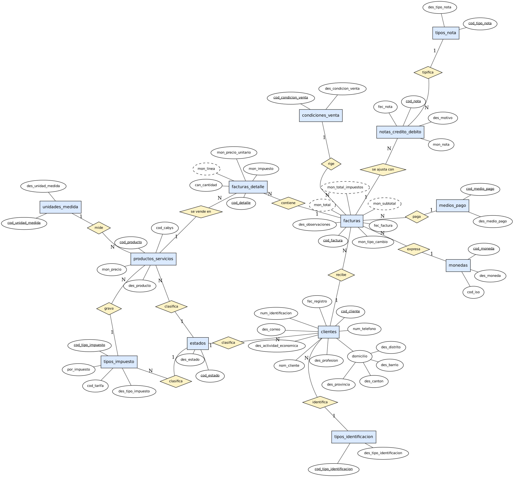
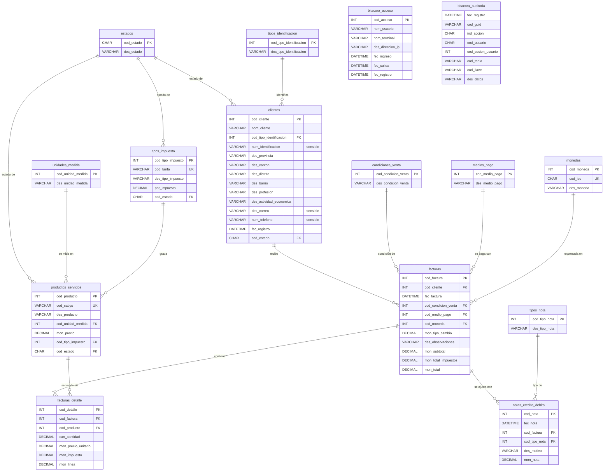

# Modelo entidad-relación y grafo relacional (REQ 001)

Base de datos `PropiFacturacion_AAMM`.

## Modelo entidad-relación

Notación de Chen: rectángulo = entidad, rombo = relación (1 / N), óvalo = atributo,
subrayado = llave primaria, punteado = atributo derivado.

## Grafo relacional

